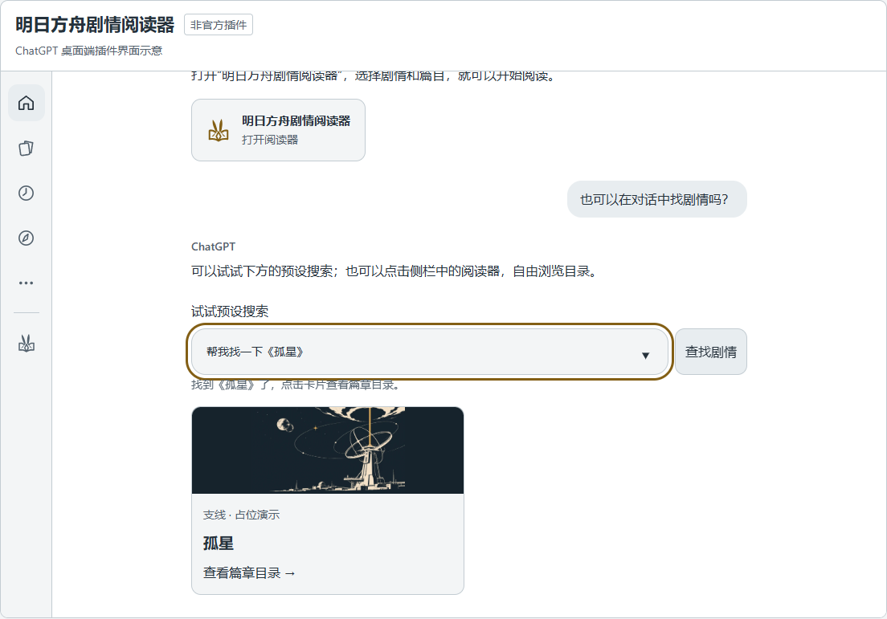
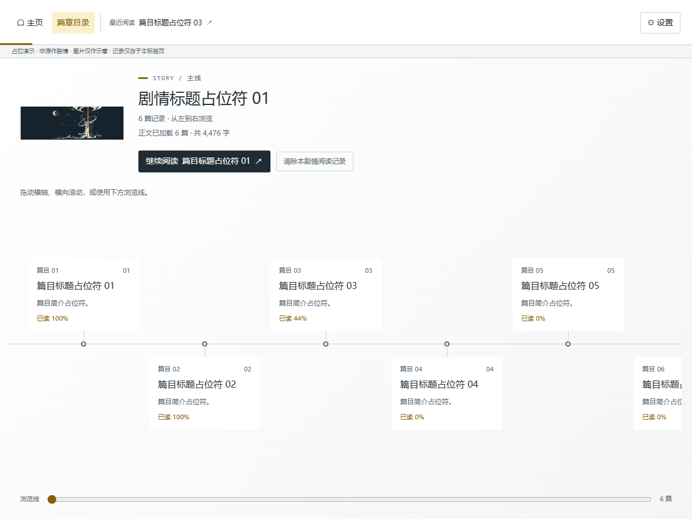
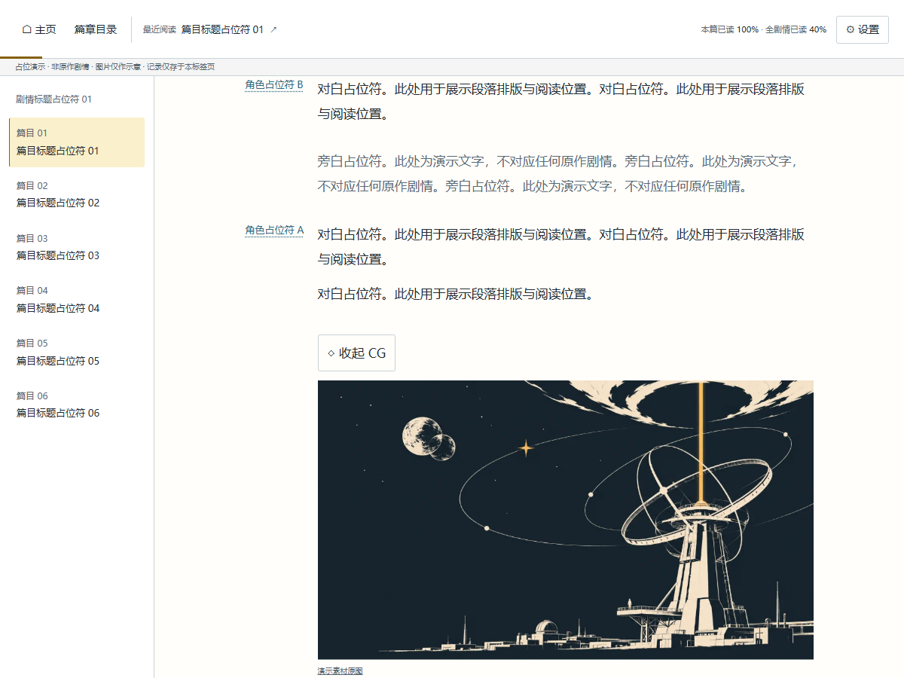
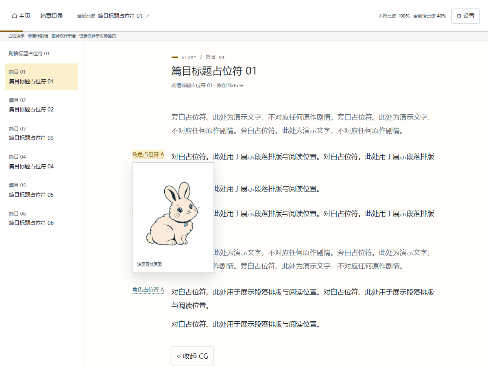

# 明日方舟剧情阅读器

在支持 MCP Apps 的桌面宿主中浏览 PRTS 剧情、阅读全部分支、按需查看图片，并保存本机阅读进度。正常阅读不需要模型 API key。

这是个人维护的非官方工具，不隶属于鹰角网络、PRTS 或 OpenAI。

[项目网站与界面示例](https://foreverstar7.github.io/arknightStoryReaderGPTPlugin/) · [安装指南](#quick-start) · [发行记录](https://github.com/Foreverstar7/arknightStoryReaderGPTPlugin/releases)

安装版本由[来源目录](https://github.com/Foreverstar7/arknightStoryReaderGPTPlugin/blob/main/.agents/plugins/marketplace.json)固定；源码实现与已验证的桌面／平台范围见[当前状态](.ai/STATUS.md)。

源码支持剧情搜索：可按剧情名称、篇目编号／标题、人物出场查询并展示卡片，点击进入篇章目录。也可以让 AI 先查找组织、地区或事件相关的剧情名称，再由工具定位。搜索不要求事先下载正文；首次按需取得 PRTS 目录和出场表，后续复用缓存。卡片不放简介，篇章目录展示可取得的 PRTS 导语。该功能的发布与真实宿主验证状态见上方当前状态。

## Quick Start

系统需 Node.js ≥26.13.0、npm ≥12.2.1，桌面客户端需能从 PATH 找到 Node。

按“添加来源 → 刷新来源 → 安装插件”依次执行，安装[来源目录](https://github.com/Foreverstar7/arknightStoryReaderGPTPlugin/blob/main/.agents/plugins/marketplace.json)固定的已验收 npm 版本。

```sh
codex plugin marketplace add Foreverstar7/arknightStoryReaderGPTPlugin
codex plugin marketplace upgrade arknights-reader
codex plugin add arknights-story-reader@arknights-reader --json
```

包内包含服务、HTML、生产依赖与启动清单；无需 clone 或构建。其他 MCP Apps 宿主的 stdio 配置见[接入说明](docs/integration-notes.md)。

`already added` 表示来源已登记，不代表已刷新清单；上面的 `marketplace upgrade` 会同步最新目录。清单固定到最新一次成功发布的精确 npm 版本。

## 升级与卸载

升级时先正常关闭旧阅读器会话，再更新来源并安装：

```sh
codex plugin marketplace upgrade arknights-reader
codex plugin add arknights-story-reader@arknights-reader --json
# 卸载插件
codex plugin remove arknights-story-reader@arknights-reader --json
```

使用[源码开发副本](#安装源码开发副本)时，将上述来源名替换为 `arknights-reader-dev`。升级、卸载和清缓存均保留外部阅读记录；清除记录要在阅读器页面中单独操作。

已安装插件不会因发布新版而后台自动升级。主动刷新来源并安装后，重启客户端或新建会话使用新版。

## 发布

修改代码并更新版本号 → 推送 main → Check 的 Ubuntu 检查通过 → 同一提交的 Windows 发行验收与固定标签／Release 草稿 → 点击一次 **Publish release** → 自动发布 npm latest 并更新正式插件清单。

发布工作流成功，npm 和 main 的插件目录都更新后才算完成。完整操作与一次性 OIDC 配置见[发布指南](docs/releasing.md)。

## 界面示例

以下截图来自网站“亲自试试”的实际阅读器组件：使用占位文案、AI 生成的线描意象图，以及带阿米娅元素的卡通动物兔子。图片只演示交互，不是官方游戏截图、原作剧情或立绘；安装后的实际阅读数据来自 PRTS。

### 对话搜索

在示意对话中输入预设的“帮我找一下《孤星》”，提交后消息进入聊天记录，输入框清空，再返回不带简介的卡片；点击进入篇章目录后展示占位简介。网站不调用模型或真实 PRTS，正式插件支持名称、篇目编号及人物出场查询。



### 剧情目录

按分类浏览剧情卡片，顶部最近阅读入口保留你实际阅读的章节。


### 篇目列表

章节沿横向篇目轴顺序排列，支持拖动浏览、整卡打开和继续阅读。



### 正文阅读

左侧切换篇目，正文纵向连续阅读；场景图片点击后原位展开，并保留阅读位置。



### 角色图片

默认关闭“自动显示图片”：点击角色姓名才显示立绘，鼠标悬停不会打开；再次点击、点击外部或按 Esc 关闭。开启该设置后，鼠标悬停姓名临时显示，离开姓名与浮层自动关闭；点击姓名仍可固定显示。CG 也由该设置控制是否在滚动接近时自动展开。

浮层左侧为“默认立绘”，右侧为“场景立绘”。优先使用能确认的剧情表情；场景与发言人不一致时显示明确提示，仍可切换查看原场景。身份或造型无法确认时保留说明，不猜测默认图；没有可靠资源的一侧置灰。匹配依据及限制见[立绘说明](docs/portrait-speaker-evidence.md)。

网页使用同一只卡通兔子作为已知角色的替身示意，匿名角色保持中性占位。



## 本地运行

项目固定 Node.js 26.13.0／npm 12.2.1。Windows PowerShell：

```powershell
./scripts/setup-toolchain.ps1
./scripts/npm.ps1 ci
./scripts/npm.ps1 run dev
```

打开 [本机开发预览](http://127.0.0.1:5173)。默认读取真实 PRTS 数据，开发记录与缓存保存在项目的 `.runtime/`。

macOS／Linux 对应使用 `sh scripts/setup-toolchain.sh` 和 `sh scripts/npm.sh`，需要 curl、tar、sha256sum／shasum；尚未实机验收。也可用自己的版本管理器准备同一工具链。

### 使用原创样例预览

在新的 PowerShell 窗口中设置来源和独立数据目录后启动：

```powershell
$env:READER_SOURCE = 'fixture'
$env:READER_DATA_DIR = Join-Path $PWD '.ai/local/preview'
./scripts/npm.ps1 run dev
```

该窗口使用原创测试正文及示意图片。关闭窗口后，其他终端的配置不受影响。正式 npm 包仅支持 PRTS，不包含 fixture。

### 构建和检查

```powershell
./scripts/npm.ps1 run check       # 类型、测试、格式
./scripts/npm.ps1 run build
./scripts/npm.ps1 start           # http://127.0.0.1:4318
./scripts/npm.ps1 run package     # .local/releases/ 中的完整运行包
./scripts/npm.ps1 run package:verify
```

[脚本说明](scripts/README.md)列出宿主探针和维护审计；[验证指南](docs/testing.md)说明如何选择检查。

### 安装源码开发副本

```powershell
./scripts/npm.ps1 run build
./scripts/npm.ps1 run plugin:prepare
codex plugin marketplace add ./.local/marketplace --json
codex plugin add arknights-story-reader@arknights-reader-dev --json
```

前两步生成新的开发副本，后两步安装到当前客户端。客户端需能从 PATH 找到项目要求的 Node；项目工具链只调整当前终端，不修改系统 PATH。为桌面客户端配置好 Node 后，正常重启客户端，再从插件入口打开阅读器。

## 数据与内容来源

- 安装模式将数据写入 Windows `%LOCALAPPDATA%/ArknightsStoryReader/`；macOS／Linux 使用 `$XDG_DATA_HOME/arknights-story-reader/`，未设置时为 `~/.local/share/arknights-story-reader/`。
- `READER_DATA_DIR` 可覆盖数据目录，不要设在插件版本目录内。阅读记录、内容缓存和公共字数分别存储，详见[接入说明](docs/integration-notes.md#本机数据)。
- 目录、正文、人物映射及图片来自 [PRTS](https://prts.wiki/)。打开一部剧情后准备该部正文，图片按需取得；不预下载整库。缓存默认在最后使用 7 天后到期。
- npm 包不附带剧情原文、游戏截图、立绘或 CG。游戏名称、角色、剧情和美术的权利属于鹰角网络及相应权利人；PRTS 的原创内容适用其[版权说明](https://prts.wiki/w/PRTS:著作权)。公开可访问不等于获得再分发许可。
- 本项目原创代码采用 [MIT 许可证](LICENSE)，不包含对游戏内容或 PRTS 内容的授权；第三方依赖遵循各自许可。来源或权利问题可通过 [GitHub Issues](https://github.com/Foreverstar7/arknightStoryReaderGPTPlugin/issues) 提供具体链接。

## 文档入口

- [阅读行为与功能范围](docs/requirements.md)
- [结构、接口与存储](docs/integration-notes.md)
- [PRTS 规则维护](docs/maintenance.md)
- [发布步骤](docs/releasing.md)

参与开发先读 [AGENTS.md](AGENTS.md) 与[当前状态](.ai/STATUS.md)。
